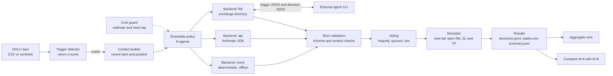
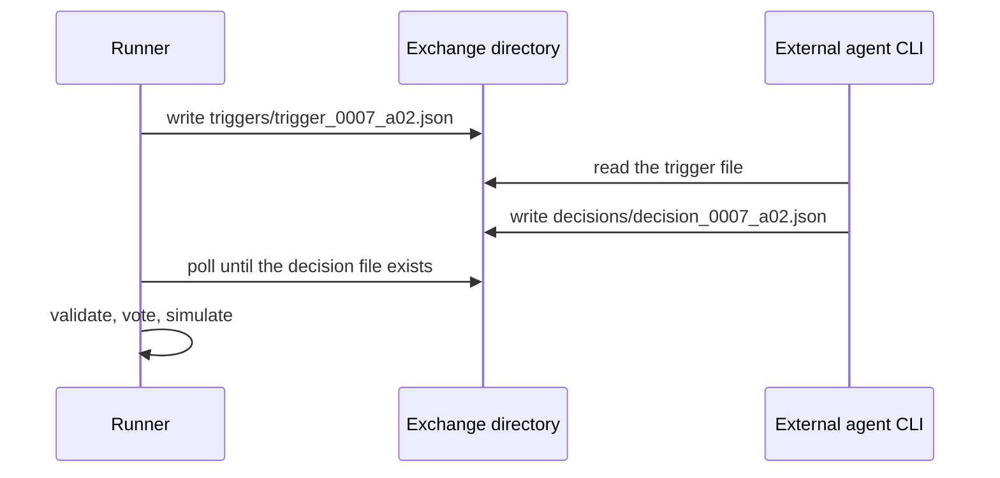

# LLM Ensemble Trader Lab

> Example policy only. Not a trading strategy and not financial advice

A small Python harness that shows how to put an LLM in a decision loop and keep it under engineering control. At event triggers on OHLC bars, N agents each answer with a structured JSON decision (BUY, SELL, HOLD or CLOSE). Every answer is validated strictly, the valid ones are combined by a consensus rule, and a simple simulator replays the result. The repository is about the plumbing: contracts, validation, voting, cost control, offline testing and swappable execution backends. The trading policy inside is a toy placeholder, and there are no performance claims anywhere in this project

## What it demonstrates

- A strict JSON contract between a model and a program, with tolerant extraction and strict validation as two separate steps
- Ensemble voting with majority and quorum rules, tie handling and explicit treatment of invalid answers
- A cost estimate before anything runs, a hard spending cap during the run, and a dry-run mode that needs no key and no network
- Three interchangeable execution backends behind one small interface: a deterministic mock, the Anthropic Python SDK, and a file exchange for external agent CLIs
- Causal trigger detection (no look-ahead) with its own test
- A way to ask "how much does the decision change with fewer agents" without paying for new model calls
- A test suite that runs offline in seconds

## Architecture



One trigger event goes through the same path in every backend. The backend only turns a request into raw text, and everything after that (validation, voting, fills) is shared code

## Quick start

Requires Python 3.10 or newer. The core package uses only the standard library

```bash
python -m venv .venv
source .venv/bin/activate          # Windows PowerShell: .venv\Scripts\Activate.ps1
pip install -e ".[dev]"            # dev extra: pytest and the optional anthropic SDK

pytest -q                          # offline, no key needed
llm-lab estimate                   # count triggers and price the run, nothing is called
llm-lab run --dry-run --agents 8 --out runs/demo
llm-lab compare runs/demo --sub-size 4
```

The first run command is the dry-run. It executes the whole pipeline with the deterministic mock backend on synthetic data, so you can look at every output file before spending anything. Example console output (mock agents, synthetic bars):

```text
cost estimate (illustrative list prices, check the provider pricing page)
  triggers      : 27
  agents        : 8
  calls         : 216
  input tokens  : ~210,336
  output tokens : ~43,200 (assumed 200 per call)
  expected cost : $0.8527 for model claude-sonnet-5-5
  upper bound   : $4.8444 (every call uses max_tokens=2048)
  mock backend  : no spend, figures above are what an API run would cost
  consulted 10/27 triggers
  consulted 20/27 triggers
  consulted 27/27 triggers
done: 27 triggers consulted, 14 consensus entries, 14 trades, 13 invalid agent answers, spent $0.0000
results in runs/demo
```

The mock injects malformed answers on purpose (about 5 percent), which is why invalid answers show up. They exercise the validation and abstention path

## Execution backends

| Backend | Flag | Needs | Use it for |
| --- | --- | --- | --- |
| mock | `--backend mock` (default, forced by `--dry-run`) | nothing | tests, dry-runs, demos, CI |
| api | `--backend api` | `ANTHROPIC_API_KEY` environment variable, `anthropic` package | direct calls through the Anthropic Python SDK |
| file | `--backend file` | a process that reads and writes JSON files | driving agent CLIs that cannot be called as a library |

### Direct API backend

```bash
export ANTHROPIC_API_KEY=<your key>     # PowerShell: $env:ANTHROPIC_API_KEY = "<your key>"
llm-lab estimate --backend api --agents 5
llm-lab run --backend api --agents 5 --out runs/api01 --set cost.max_usd=2
```

- The key is read only from the `ANTHROPIC_API_KEY` environment variable, never from a file or a flag
- The model id is configurable and defaults to `claude-sonnet-5-5` (`--model` or `backend.model`)
- The request carries a cacheable system prompt, `output_config.effort` (default `low`), and optionally schema-constrained output (`backend.structured_output`)
- No sampling parameters are sent, because newer models reject non-default values
- Authentication and bad-request errors stop the run with a clear message. Rate limit, server and connection errors are retried by the SDK, and if they still fail the agent abstains for that trigger. Refusals and answers cut at `max_tokens` abstain as well
- `backend.server_side_fallback` is an opt-in switch for provider-side fallback routing on refusals, off by default

### File-exchange backend

This mode reproduces a "dump the context to disk, let an external agent answer, read the answer back" loop. The runner stays in the foreground and polls



```bash
llm-lab run --backend file --agents 3 --exchange-dir exchange --out runs/file01
```

Start one agent per index (0, 1, 2) with the prompt template in `agents/toy-decision-agent-exchange.md`. Each trigger file is self-contained: system prompt, rendered user prompt, structured context, the JSON schema and the path to write

- Files are named from integers only (`trigger_0007_a02.json`), so nothing from the data can reach a path
- Decision files are size-capped and validated like any other answer
- If the wait times out the run stops and says which file it was waiting for. Start it again with the same configuration and existing decision files are reused, so an interrupted session resumes
- The exchange directory carries a fingerprint of the run configuration, and a directory from a different configuration is refused so stale decisions are never replayed

`agents/toy-decision-agent-single-shot.md` is a second template for orchestrators that start N one-shot agents per trigger and collect their JSON replies

## Cost control

The estimator prices a run before it starts, from the prompts that would actually be sent (one per trigger, no position state):

- calls = triggers x agents
- input tokens are estimated from character counts (`cost.chars_per_token`, default 3.0, deliberately conservative)
- expected output uses `cost.assumed_output_tokens`, the upper bound assumes every call uses the full `max_tokens`
- `cost.cache_hit_rate` (default 0) lets you model prompt caching. Short system prompts can fall under a model's minimum cacheable length, so the default assumes no caching
- an unknown model without explicit prices is an error, never a silent zero

Guardrails for API runs: the run is refused when the expected cost is above `cost.max_usd`, and it is aborted when real spend (from the usage reported by each response) passes the cap. An aborted run keeps its partial results and exits with code 3

The built-in price table is an illustrative snapshot. Override it with `cost.price_input_per_mtok` and `cost.price_output_per_mtok`, and check the provider pricing page before trusting any figure

## Decision contract and validation

Every agent must answer with one JSON object:

```json
{"action": "BUY", "sl_price": 99.5, "tp_price": 101.0, "reasoning": "at most 200 characters"}
```

Validation is layered, and each layer has its own failure message:

| Layer | Function | What it checks |
| --- | --- | --- |
| Extraction | `extract_json_object` | one JSON object in the text, code fences and short prose around it tolerated, NaN and Infinity rejected |
| Structure | `parse_decision` | exact action names, numbers are real numbers (not strings, not booleans), BUY and SELL need both levels, HOLD and CLOSE need both null, no unknown keys |
| Context | `check_against_context` | price geometry (long: stop below price below target), no entry while a position is open, no CLOSE while flat, stop distance and reward to risk limits |

An answer that fails any layer becomes an abstention for that agent and the reason is stored in `decisions.jsonl`

## Ensemble voting

Each agent contributes a validated decision or an abstention. The rule is configured under `ensemble.rule`:

| Setting | Values | Meaning |
| --- | --- | --- |
| `mode` | `majority` | an action needs strictly more than half of all members, so `N // 2 + 1` votes |
| `mode` | `quorum` | an action needs `quorum_votes`, or strictly more than `quorum_fraction x N` votes (capped at N) so the same rule scales to other sizes |
| `tie_policy` | `hold` | leaders with equal counts produce HOLD |
| `tie_policy` | `priority` | the first leader in the `priority` list wins, default order prefers doing nothing |
| `invalid_vote_policy` | `abstain` | invalid answers are not counted |
| `invalid_vote_policy` | `hold` | invalid answers count as HOLD |
| `min_valid_fraction` | 0 to 1 | below this share of valid answers the ensemble answers HOLD |

The default rule is `quorum` with `quorum_fraction` 0.5, a simple majority: an action wins only with strictly more than half of the votes. For N=8 that is 5 votes, and for N=4 it is 3. Exactly half is never enough. The bar is set from the full ensemble size N and only valid answers count toward it, so an invalid answer under the `abstain` policy never lowers the bar

When the winner is an entry, its stop and target are the median of the agreeing agents' levels, so the consensus is always a concrete, executable decision

## Comparing N=4 with N=8

Question: how much would the consensus change if fewer agents voted? The comparison needs no new model calls:

1. A run queries all N agents at every trigger and stores each answer in `decisions.jsonl`
2. Every size-k subset of the N agents (70 subsets for 4 of 8) is re-voted on the stored answers, with the same rule scaled to k
3. Each subset's consensus is compared with the full ensemble's consensus, trigger by trigger

```bash
llm-lab run --dry-run --agents 8 --out runs/demo
llm-lab compare runs/demo --sub-size 4
llm-lab compare runs/demo --sub-size 4 --fractions 0.5 0.75 0.9     # sweep the quorum fraction
```

Example output (mock agents on synthetic data, so the numbers only illustrate the format):

```text
[quorum] full N=8 needs 5 votes, sub-ensembles N=4 need 3 votes, 70 of 70 subsets
  triggers evaluated            : 27
  entry signals, full ensemble  : 14
  entry signals, sub-ensembles  : mean 11.13  std 1.50  min 8  max 14
  agreement with full ensemble  : mean 0.847  std 0.066  min 0.704  max 0.963
  triggers that flip in any subset: 15  (mean flip rate 0.153)
```

The comparison keeps the market context fixed at each trigger (the context seen in the reference run). It measures voting stability, and it does not re-simulate trades. For larger ensembles it samples subsets with a seeded generator (`--max-combos`). Several runs can be summarized with `llm-lab aggregate runs/a runs/b runs/c`

## Configuration

Every tunable value lives in `src/llm_ensemble_lab/config.py`, and `configs/default.json` is the full default document. Use a file, single overrides, or both (values are parsed as JSON, and anything that is not valid JSON is taken as a plain string):

```bash
llm-lab run --dry-run --config configs/default.json --set trigger.lookback=24 --set ensemble.rule.mode=majority
llm-lab show-config            # print the defaults
```

All defaults (trigger parameters, volatility multiples in the toy policy, spread, limits) are arbitrary placeholders chosen to make the demo run. None of them were tuned or optimized

### Trigger

The shipped trigger is `return_zscore`. It computes the log return of every bar. At bar t it takes the mean and the standard deviation of the previous `lookback` returns (strictly before t, so the candidate never influences its own threshold) and fires when `abs((r_t - mean) / std) >= z_threshold`. The event is "up" for a positive z-score and "down" for a negative one, and a `cooldown_bars` pause follows each event. Warm-up bars and windows with zero spread never fire. Detection is causal: one test appends future bars and another rewrites them, and both check that earlier events do not change. New triggers implement the small `Trigger` protocol in `triggers.py` and register in `TRIGGERS`

### Policy

The system prompt has a fixed contract part and a swappable policy block. The default block is a labeled toy ("if the trigger is up and the previous bar closed up, answer BUY" and similar). Its stop and target sit `prompt.stop_vol_mult` and `prompt.target_vol_mult` times `price_vol` away from the close, where `price_vol` is the standard deviation of returns times the close. That is a toy rule for the demo, not a risk model. Point `prompt.policy_file` at a text file to replace it

## Output files

A run directory contains:

| File | Content |
| --- | --- |
| `config.json` | the resolved configuration of the run |
| `decisions.jsonl` | one line per trigger: every agent's answer or abstention reason, and the consensus with its vote counts |
| `trades.csv` | simulated trades with entry, exit, levels and exit reason |
| `summary.json` | counts (triggers, calls, invalid answers) and trade statistics |
| `cost.json` | the pre-run estimate and the usage actually reported |

## Fill model

- A decision on bar i executes at the open of bar i+1
- Every fill pays a half spread (basis points of price), configurable
- Stop and target are checked inside the bar. If both fall inside the bar range, the stop is assumed to hit first
- A stop already crossed at the open fills at the open
- One position at a time, and an open position is closed at the last close

## Project layout

```text
src/llm_ensemble_lab/
    config.py            run configuration dataclasses, JSON load and validation
    bars.py              OHLC container, CSV input and output, log returns
    synthetic.py         GBM with regime switches, hourly bars
    triggers.py          trigger protocol and the return z-score example
    prompts.py           system prompt, context builder, user prompt renderer
    schema.py            decision contract, extraction, strict validation
    voting.py            majority, quorum, ties, invalid votes
    ensemble.py          N agents per trigger, validation, retries, parallel calls
    backends/            mock.py, api.py, file_exchange.py behind one interface
    cost.py              usage, pricing, estimator, budget guard
    backtest.py          event loop and simple fill model
    results.py           trade CSV, summaries, aggregation across runs
    ensemble_compare.py  sub-ensemble comparison
    runner.py            orchestration and result files
    cli.py               llm-lab command
agents/                  prompt templates for external agent CLIs
data/                    sample synthetic CSV and the script that regenerates it
configs/default.json     full default configuration
tests/                   pytest suite
```

## Tests

```bash
pytest -q
```

The suite covers decision validation (valid and malformed answers), voting edge cases (quorum, ties, invalid votes, empty ensembles), the cost estimator and budget guard, trigger causality, a spike that fires and flat data that does not, the fill model, the three backends (the API backend against a stubbed client), the ensemble comparison, the CLI, and an end-to-end dry-run on synthetic data. It also checks the repository for stray dash characters, absolute drive paths and key-like strings. No test needs a key or a network connection

## Design decisions

- **Mock first.** A deterministic backend means the whole pipeline is testable and demoable without a key, and a dry-run shows the real output files before any spend
- **Extraction and validation are separate.** Models wrap JSON in prose or fences. Tolerating that in one small function while keeping the contract strict everywhere else keeps failures easy to read
- **Abstention instead of a guess.** A broken answer never turns into a default trade. It is a recorded abstention, and the consensus rule decides what a thin vote means
- **Median levels for consensus entries.** A voted entry needs one stop and one target, and the median of the agreeing agents is robust to a single outlier
- **Cost is a first-class input.** The estimate runs before the first call and the cap is enforced from reported usage, not from the estimate
- **Idempotent file exchange.** Deterministic trigger ids plus reuse of existing decision files make an interrupted session resumable without any state file
- **Standard library core.** The harness needs no dependency, the SDK is imported lazily and only for the api backend

## Limitations

- The policy, the trigger parameters and the synthetic data are placeholders. Results from this repository say nothing about any market, and mock agents are not language models
- The API backend is tested against a stubbed client only. It has not been exercised against the live service in this repository, and the optional switches `structured_output` and `server_side_fallback` in particular should be tried on a small run first
- Ensemble members are samples from the same model, so their errors are correlated. Agreement between them is not independent evidence
- No sampling parameters are sent, so diversity comes from the model's default sampling and cannot be tuned here
- If you replace the synthetic data with a real price history, a model may have seen that period during training, which can leak information into a backtest
- The fill model is simple: fixed half spread, no slippage model, no fees, no latency, no partial fills, and a conservative but crude intra-bar ordering rule
- Token counts are heuristic and the price table is a snapshot, so treat the estimate as a planning figure
- The sub-ensemble comparison holds the context fixed and does not re-simulate trades
- The file exchange is a single-machine polling design with no locking between competing writers

## License

MIT, see [LICENSE](LICENSE)
